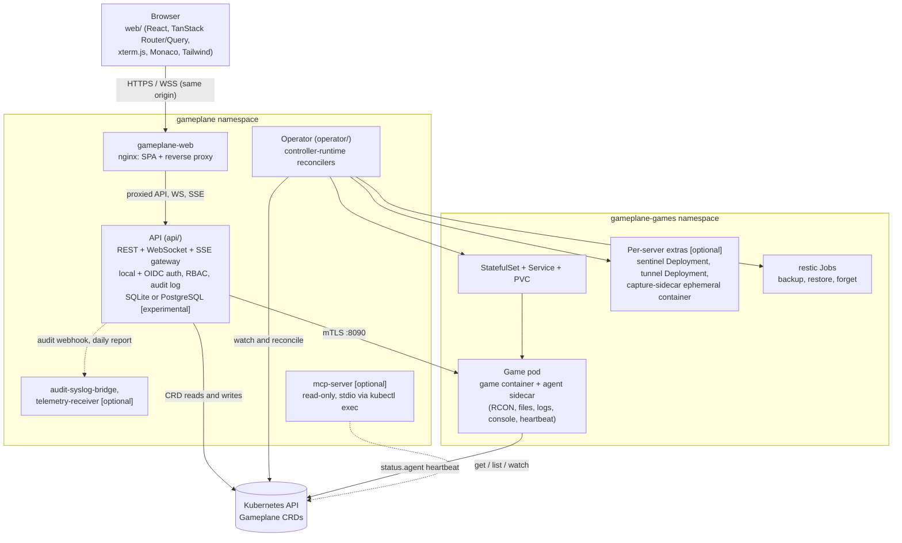
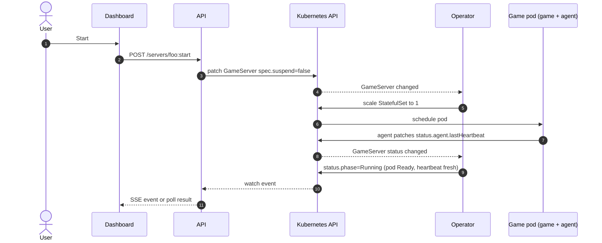

import ArchFlow from "../../components/docs/ArchFlow.astro";

<ArchFlow
  nodes={[
    { icon: "laptop", title: "Browser", subtitle: "User" },
    { icon: "server", title: "API", subtitle: "Gateway" },
    { icon: "workflow", title: "Operator", subtitle: "Controller" },
    { icon: "boxes", title: "Kubernetes", subtitle: "Cluster" },
    { icon: "cpu", title: "Agent", subtitle: "Sidecar" },
  ]}
  caption="In the home cluster, console and log traffic flow API ↔ Agent directly over mTLS; the Operator provisions and reconciles both. Remote clusters go through an optional gateway (below)."
/>

## Why two control planes

The Operator reconciles CRDs declaratively; the API layer handles sessions, RBAC, and audit. kubectl and the dashboard always agree.

## Data flow

A dashboard action cascades: API → Operator → StatefulSet → Agent → heartbeat → status → browser refresh.

The component map below shows which services run in the panel namespace and the games namespace, and how they talk to each other.

The sequence below traces a Start action from the dashboard to a Running status.

## Module system

ModuleSource CRs declare where templates come from — OCI registry, git, HTTP, local, or dashboard upload. Combined panels manage the local module catalog; standalone panels require an explicit registered cluster for module and source operations.

## Multiple clusters and the gateway

One central API and dashboard can manage independent clusters registered with the panel: as `Cluster` resources in a combined installation, or in the database of a [standalone panel](../standalone-panel/), which runs without a local cluster. A combined installation runs the panel and a local operator in one cluster. Each target cluster runs its own operator, and optionally a private gateway built from the API image. The gateway has no database, no user login and no browser or admin routes. Users authenticate only to the central API, which stays the authorization authority.

<ArchFlow
  nodes={[
    { icon: "laptop", title: "Browser", subtitle: "User" },
    { icon: "server", title: "Central API", subtitle: "AuthZ" },
    { icon: "network", title: "Gateway", subtitle: "Per cluster" },
    { icon: "cpu", title: "Agent", subtitle: "Sidecar" },
  ]}
  caption="Central API ↔ Gateway uses a dedicated mTLS trust and an exact enrolled client URI SAN; Gateway ↔ Agent uses the local agent mTLS and UID-bound routes."
/>

- **Resource requests** carry `?cluster=<name>` and go to that cluster's Kubernetes client. Omitting it targets the built-in `local` cluster. Collection reads under `/fleet/*` instead combine authorized scopes by default, with optional cluster and namespace filters; each item keeps its target identity and permissions, and partial results report unavailable or truncated scopes.
- **Pod logs and PTY attach** resolve the Kubernetes client for each connection from the registry; unknown or removed clusters fail closed. The API checks the GameServer, StatefulSet and Pod owner UIDs first. Kubernetes log and attach APIs address Pods by name, so this is a preflight check, not an atomic guarantee across deletion and recreation.
- **RCON, game log files, files, players, live status and agent-based mods** use the selected cluster's gateway. It verifies the central peer certificate, its own cluster ID, the GameServer UID and the owned agent Service, then reaches the agent over local DNS and agent mTLS. Versioned agent routes verify the UID on the final hop; older agents fail closed. Browser cookies, bearer tokens and CSRF headers are never forwarded.
- **Capture downloads and cleanup** use a separate gateway route bound to both the GameServer and NetworkCapture UIDs; the sidecar verifies a persisted file identity.
- **Existing local installs** keep direct API-to-agent connections. Remote gateway access needs both private gateway reachability and direct Kubernetes API access from the central API; it does not tunnel Kubernetes operations or replicate game storage.

In a combined installation, the `Cluster` health phase reports Kubernetes connectivity and does not probe the gateway; a standalone panel polls remote Kubernetes health from the API every 30 seconds. See the [remote agent gateway guide](../remote-agent-gateway/) for installation and the [multi-cluster guide](../multi-cluster/) for what works across clusters. The gateway ships in v0.3.0.

## Optional components

Beyond the core operator, API, and agent, Gameplane ships optional services for specialized tasks. Optional components (mcp-server, telemetry-receiver, audit-syslog-bridge) are covered in [Extension services](../extension-services/). For a full catalog of all CRDs and their fields, see the [CRD catalog](../crd-catalog/).

The full component reference — data-flow walkthroughs, CRD relationships, and security boundaries — lives in the [architecture doc on GitHub](https://github.com/GameplanePanel/Gameplane/blob/master/docs/architecture.md).
