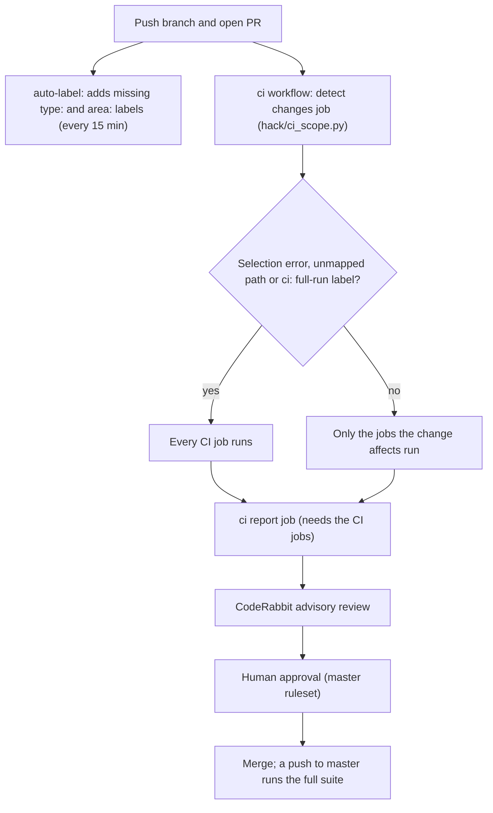
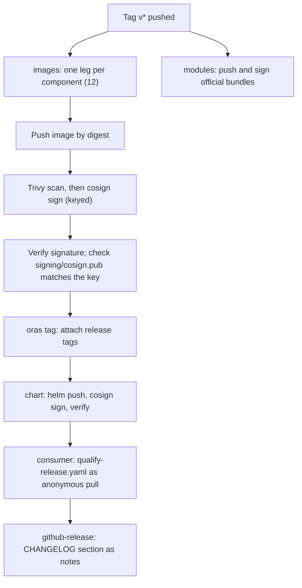
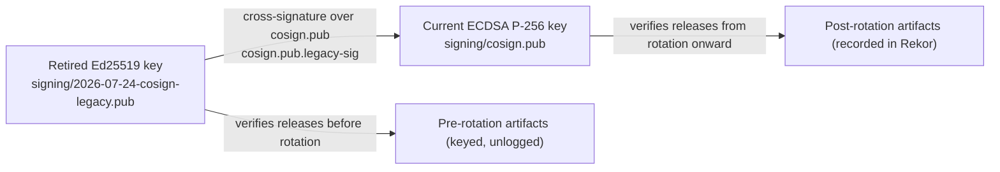

import DocsCallout from "../../components/docs/DocsCallout.astro";
import DocsSectionList from "../../components/docs/DocsSectionList.astro";
import DocsQuickReference from "../../components/docs/DocsQuickReference.astro";

<DocsCallout icon="info" title="Edge channel is beta software">
  The rolling `:edge` channel is test software; production installs should pin a tagged chart and immutable image digests.
</DocsCallout>

## Continuous integration

CI covers Go modules, envtest, web build/coverage, browser tests, Helm rendering, and disjoint Kind E2E buckets.

The flowchart below shows how a pull request moves from its push to merge, and which CI jobs run.

<DocsSectionList
  items={[
    {
      icon: "check",
      label: "Matrix tests",
      text: "Every Go module and required build tag is tested.",
    },
    {
      icon: "arrow-up-right",
      label: "Coverage gates",
      text: "Coverage is merged and enforced per component.",
    },
    {
      icon: "boxes",
      label: "E2E completeness",
      text: "Helm and bucket-coverage checks protect generated and E2E completeness.",
    },
  ]}
/>

## Edge channel

Changes on master publish rolling `:edge` images and immutable `sha-<short>` tags for all released components.

<DocsSectionList
  items={[
    {
      icon: "layers",
      label: "Multi-architecture",
      text: "Images are multi-architecture and optionally signed by digest.",
    },
    {
      icon: "arrow-right",
      label: "Immutable pinning",
      text: "Commit-based sha tags provide immutable commit pinning.",
    },
    {
      icon: "file-code",
      label: "Docs/design-only",
      text: "Docs and design-only changes require direct review because code CI may skip them.",
    },
  ]}
/>

## Tagged release

A `v` tag builds and signs images, packages the OCI chart, creates release notes, and publishes official modules.

The flowchart below shows the jobs that a release tag starts and the order of the image and chart steps.

<DocsQuickReference
  label="RELEASE PATH"
  items={[
    "go build ./... && npx tsc --noEmit  # Lightweight local compile checks",
    "git tag vX.Y.Z && git push origin vX.Y.Z",
    "cosign verify --key signing/cosign.pub ghcr.io/gameplanepanel/gameplane/<image>@<digest>",
  ]}
/>

Release images carry Cosign signatures recorded in the public Sigstore Rekor transparency log. Verify any released or edge image with the `signing/cosign.pub` key. Pre-rotation releases (v0.2.0-beta.7 and earlier) used the retired Ed25519 key and require `signing/2026-07-24-cosign-legacy.pub` with the `--insecure-ignore-tlog=true` flag (see [Key Rotation](../credential-rotation/) for trust continuity).

The flowchart below shows how the retired legacy key and the current key vouch for releases.

Signing is mandatory and fail-closed: without `COSIGN_PRIVATE_KEY` the release job fails before anything is pushed. Every signing job (`release.yaml`, `publish-edge.yaml`, `images.yaml` and `republish-modules.yaml`) runs in the `release-signing` environment, whose deployment policy admits only `master` and `v*` tags, so a run on any other ref never receives the key. Images are pushed by digest, signed and verified, and only then tagged, so a published tag always names a signed image.

---

## Next guide

[Extension services](../extension-services/)
