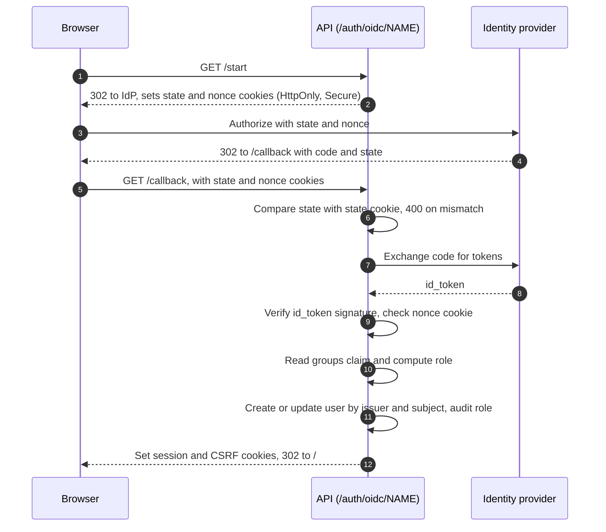
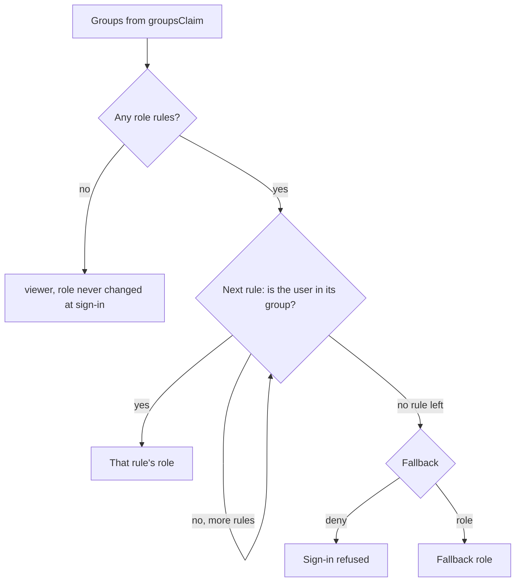
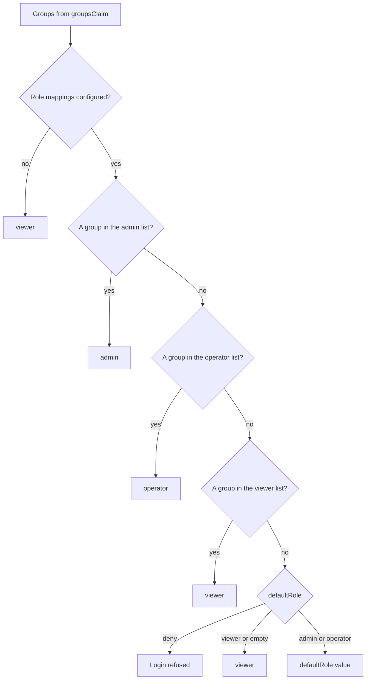

import DocsCallout from "../../components/docs/DocsCallout.astro";
import DocsSectionList from "../../components/docs/DocsSectionList.astro";
import DocsQuickReference from "../../components/docs/DocsQuickReference.astro";

Gameplane's authentication and authorization system combines local user accounts, optional OIDC single sign-on, built-in and custom roles, per-server ownership, and per-namespace role bindings. The model prevents lockout by requiring at least one tested administrative recovery path before enabling OIDC-only mode.

<DocsCallout icon="shield-alert" title="Keep one tested administrative recovery path">
Keep a local admin session open while testing the identity provider, and verify redirect URIs, claims, groups, and mapped permissions in a private session before enforcing SSO-only behavior.
</DocsCallout>

## Users and service accounts

Invite and edit local users, reset credentials deliberately, and give automation its own account rather than a shared login.

<DocsSectionList
  items={[
    {
      icon: "check",
      label: "Strong passwords and dormant account removal",
      text: "Require strong passwords and remove dormant local accounts.",
    },
    {
      icon: "check",
      label: "Automation accounts",
      text: "Give each automation its own local user with the minimum role, and rotate its password. Service accounts with API tokens are planned for v1.1.",
    },
    {
      icon: "check",
      label: "Audit user lifecycle",
      text: "Audit invites, resets, disabled accounts, and ownership transfers.",
    },
  ]}
/>

Local users are invited via the dashboard (**Admin Settings → Users → Add user**). Set the user's initial password directly (or leave it blank for an OIDC-only account) and share it with them out of band; there is no built-in email invite flow. Gameplane has no API tokens yet. For automation, create a dedicated local user with an appropriate custom or built-in role (usually `viewer` or `operator` scoped to specific namespaces) and have scripts sign in as it, sending the session cookie and CSRF header as shown in the [REST API reference](../rest-api-reference/).

## Roles and permissions

Built-in and custom roles group explicit permissions for servers, backups, templates, users, and platform operations.

<DocsSectionList
  items={[
    {
      icon: "check",
      label: "Start with read-only permissions",
      text: "Start with read-only and add mutation permissions by workflow.",
    },
    {
      icon: "check",
      label: "Separate global and per-server",
      text: "Separate global administration from per-server collaboration.",
    },
    {
      icon: "check",
      label: "Review new features",
      text: "Review custom roles after new features introduce additional permissions.",
    },
  ]}
/>

### Built-in roles

Gameplane defines three built-in roles that cannot be deleted:

- **Admin**: Full access to all resources, including users, roles, and global settings.
- **Operator**: Manage game servers, backups, templates, and backup schedules. Read access to modules, backup destinations, cluster info, and the permission catalog.
- **Viewer**: Read-only access across the control panel (servers, backups, templates, modules, cluster info, permissions).

### Custom roles

Create custom roles under **Admin Settings → Roles** to combine specific permissions. Each permission is either cluster-wide (`Namespaced: false`) or server-namespace-scoped (`Namespaced: true`). Cluster-wide permissions grant access to all namespaces; namespace-scoped permissions can be granted per-server via role bindings.

The permission catalog includes:

- **Game servers:** View servers, create/edit/control servers, use the console (RCON / PTY).
- **Backups:** View, create/delete, and restore backups; view and manage schedules.
- **Game templates:** View, create/edit, delete.
- **Modules:** View the catalog, install/upgrade/uninstall modules and sources.
- **Backup destinations:** View and manage destinations.
- **Cluster:** View nodes/version/storage, add nodes and mint kubeconfig.
- **Users:** View users and their role bindings, create/edit/delete users.
- **Roles:** View roles and the permission catalog, create/edit/delete custom roles.
- **Audit log:** View audit events.
- **Global settings:** View and manage global platform settings (authentication, notifications, telemetry, module upload limits).
- **Network captures:** Enable, start, stop, download, and delete packet captures (cluster-wide only).

Owner-only server operations (transferring ownership, editing collaborators, wiping data, deleting the server) require either the server's owner or an admin. Operator-role users keep their other server permissions but cannot perform these four operations on servers they don't own.

**Admin-level grants (v0.4.0).** `users:manage`, `roles:manage`, `config:manage` and `cluster:manage` lead to full administrator access. Only a holder of the `*` wildcard can add them to a role, assign a role that carries them, or edit, reset, delete or re-bind an account that holds them. Sign-in provider settings also need `*`. Holders of the other managing permissions can still grant every non-admin permission.

**Selected-cluster catalogs (v0.4.0).** In combined and standalone installations, module and template catalog access needs a cluster-wide grant on the selected cluster or on all clusters (`*`). A grant on `local` keeps local access but does not authorize a remote catalog, and namespace-only grants never authorize a catalog.

## OIDC and SSO

Configure identity providers through Helm install-time settings or the dashboard, validate claims and role mappings, and test the flow in a private session before enforcing SSO-only mode.

### Runtime configuration (dashboard)

Add OIDC providers under **Admin Settings → Authentication → Add provider**. Fill in the issuer URL, client ID, and client secret (stored securely in a Kubernetes Secret). The callback URL is automatically derived from your external URL setting.

Supported providers include Keycloak, Authentik, Google, GitHub, and any RFC-7519 compliant OpenID Connect provider. Detailed setup guides for Keycloak, Authentik, Google, and GitHub follow the same issuer/client ID/secret pattern.

When a user logs in via OIDC for the first time, Gameplane creates a user row. Without role rules the role is `viewer` and admins must promote new OIDC users manually via the dashboard or custom role bindings; with role rules the role comes from the user's IdP groups (see SSO group role rules below).

The sequence below shows the OIDC sign-in round trip between the browser, the API, and the identity provider.



### SSO group role rules

<DocsCallout icon="milestone" title="New after v0.4.3">
  Role rules and role source ship in the first release after v0.4.3. Earlier releases use the per-role mappings described in Install-time role mappings below.
</DocsCallout>

Each SSO provider maps IdP groups to roles with an **ordered list of rules**. A rule says "members of group X get role Y".

- **Any role.** A rule can name a built-in role (`admin`, `operator`, `viewer`) or a custom role such as `login-only`.
- **First match wins.** Rules are checked from the top, and the first rule whose group the user is in decides the role. Order decides, not privilege: a `viewer` rule above an `admin` rule gives viewer to members of both groups.
- **Exact match.** Group names are matched exactly and case-sensitively against the groups claim. Spaces and punctuation are allowed.
- **Fallback.** If no rule matches, the fallback role applies: viewer, `deny` (refuse the sign-in), or any role that exists.
- **Missing roles.** The dashboard refuses to save a rule or fallback that names a role that does not exist, and refuses to delete a role that a rule or fallback uses.
- **Mapping off.** A provider with no rules keeps roles as they are: new users get viewer and sign-in never changes a role.

Edit the rules under **Admin Settings → Authentication**, in the provider form or, for the Helm-configured provider, in the role rule override card. The editor adds, removes and reorders rules, warns when a group already appears in an earlier rule, and asks for confirmation before a save gives a group the admin role. For the Helm provider, the dashboard override replaces the whole Helm rule list and fallback; **Reset to Helm default** removes it.

The flowchart below shows how the API picks a role from the user's groups.



#### Role source

Gameplane records who set each SSO user's current role, and the Users page shows it as a badge:

| Badge | Meaning |
|---|---|
| From SSO | The rules set the role. Each sign-in applies the rule result, including demotion when the user leaves a group. |
| From SSO (applies at next sign-in) | An admin returned the user to SSO control. The role stays the same until the next sign-in. |
| Set by hand | An admin set the role on the Users page. Sign-in never changes it, and the user is let in even when no rule matches and the fallback is `deny`. |

Changing an SSO user's role on the Users page marks it **Set by hand**. To hand the role back to the rules, choose **Return to SSO control** on the user. On upgrade, users linked to an SSO account start as From SSO and all other users as Set by hand; no role changes.

Every SSO sign-in that changes, keeps or refuses a role writes an audit event of the form `oidc role decision: provider=… rule=… group=… role=… source=… result=…`, so you can see which rule matched and whether it was applied. A demotion that would remove the last user who can manage users is skipped and recorded, as before.

### Install-time role mappings

<DocsCallout icon="milestone" title="Available since v0.3.0">
  Install-time role mappings are available since v0.3.0.
</DocsCallout>

Helm role mappings eliminate the need for a `bootstrap-admin` account in OIDC-only deployments. Operators configure group mappings at install time, and the first user to log in receives the correct role immediately based on their IdP group membership.

When deploying with Helm, set `api.oidc.enabled=true`, `api.oidc.groupsClaim` to the name of your IdP's groups claim (e.g., `"groups"`), and list the rules in `api.oidc.roleRules`. On first login, Gameplane matches the user's groups against the rules and assigns the first matching rule's role.

```yaml
api:
  oidc:
    enabled: true
    groupsClaim: "groups"
    defaultRole: "deny"
    roleRules:
      - group: "sys-admin"
        role: "admin"
      - group: "gameplane login only"
        role: "login-only"
```

Create custom roles such as `login-only` before users sign in; a rule naming a role that does not exist refuses the sign-in.

**Old per-role keys.** `api.oidc.roleMappings.{admin,operator,viewer}` keeps working and is read as rules in the order admin, then operator, then viewer, which gives the same role as before (the highest-privilege matching role). Set either `roleRules` or `roleMappings`, not both: the chart fails to render when both are set.

With the old per-role keys, the role is picked as in the flowchart below.



After deployment, admins can override the Helm rules through the dashboard without restarting the API. Helm upgrades preserve dashboard customizations — they do not overwrite rules that have already been edited in the UI. For detailed Helm value examples and troubleshooting, see the [OIDC provider setup documentation](https://github.com/GameplanePanel/Gameplane/blob/master/docs/oidc.md#role-mapping-at-install-time-no-bootstrap-admin-required) on GitHub.

<DocsQuickReference
  label="LOCKOUT PREVENTION"
  items={[
    "Keep a local admin session open while testing the identity provider",
    "Verify redirect URI, issuer, claims, groups, and mapped permissions",
    "Test login and logout in a private session before enforcing SSO-only",
  ]}
/>

---

**Next guide:** [Audit, observability, and administration](../audit-observability-admin/)
